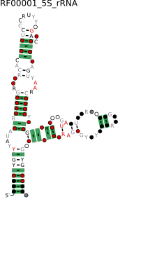
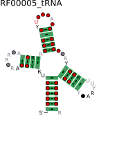
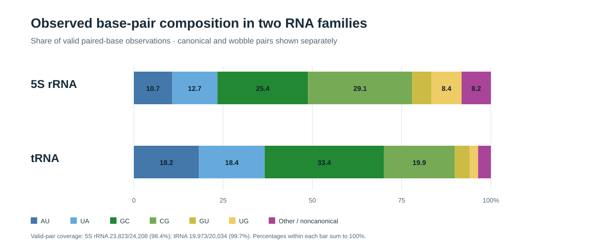
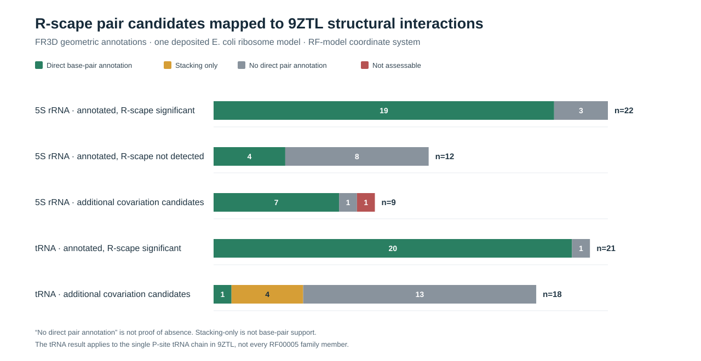
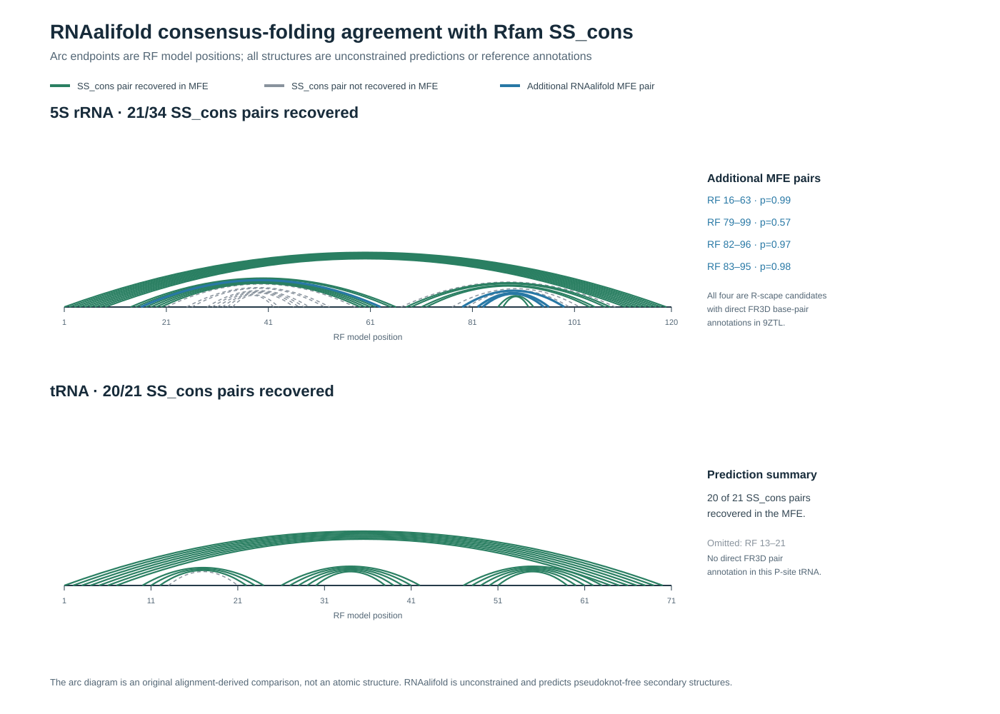
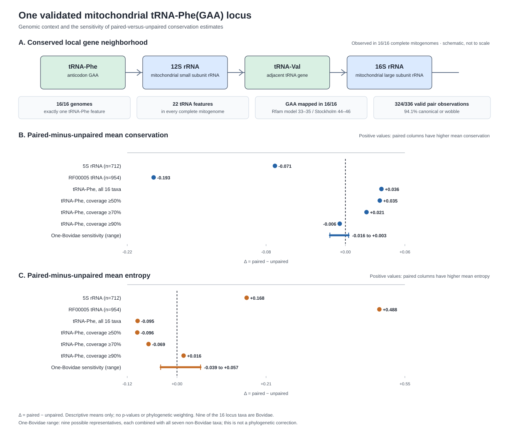

# Sequence Conservation and Structural Constraints in tRNA and 5S rRNA

*A descriptive RNA biology research report*

**Author:** Nima Ghobadi ·  [0009-0009-6146-3045](https://orcid.org/0009-0009-6146-3045)

## Abstract

This report compares paired and explicitly unpaired consensus positions in the Rfam 15.1 seed alignments for 5S ribosomal RNA (RF00001; 712 aligned sequences) and transfer RNA (RF00005; 954 aligned sequences). After excluding reference-annotation insertion columns, it summarizes per-column nucleotide conservation, Shannon entropy, and observed canonical or wobble base-pair types, with gaps and ambiguous residues handled explicitly. Paired columns show lower mean single-site conservation and higher mean entropy than unpaired columns in both selected seeds. The paired-minus-unpaired conservation contrasts are −0.071 for 5S rRNA and −0.193 for tRNA; the corresponding entropy contrasts are +0.168 and +0.488 bits. Canonical or wobble pairs account for 91.8% of valid 5S pair observations and 96.4% of valid broad-tRNA pair observations. The between-seed difference is descriptive and is not a family-level inferential test. Supporting figures compare consensus structure, covariation, geometric annotations, comparative-folding predictions, and selected RNA regions in one deposited ribosome structure. A separate 16-species mitochondrial tRNA-Phe(GAA) subset is validated for that locus only; its single-site conservation direction is sensitive to sampling and coverage. The report does not establish compensatory evolution, causation, a universal family-wide rule, or a novel method.

**Keywords:** RNA biology; RNA structure; sequence conservation; Shannon entropy; 5S rRNA; transfer RNA; Rfam; RNA bioinformatics; covariation; descriptive analysis

**Field:** RNA Biology, RNA Bioinformatics, and Cell Biology, with a focus on RNA structure  
**Data:** public Rfam seed alignments RF00001 (5S rRNA) and RF00005 (tRNA)

## 1. Research questions and study objectives

### Primary research question

**RQ1.** Within each of the two selected public Rfam seed alignments, do positions annotated as paired in the consensus secondary structure differ from explicitly unpaired positions in single-site sequence conservation and Shannon entropy?

### Secondary descriptive questions

- **RQ2 (original question A — single-site variation):** How do mean nucleotide conservation and mean Shannon entropy compare between paired and explicitly unpaired columns in each seed alignment?
- **RQ3 (original question B — pair composition):** Among valid observations at annotated paired positions, what proportions are canonical Watson–Crick pairs, GU/UG wobble pairs, or other pair types?
- **RQ4 (original question C — between-seed description):** How different are the paired-minus-unpaired contrasts between the selected 5S rRNA and broad tRNA seed alignments?

### Supporting biological-context questions

- **RQ5 (structural context):** How do consensus-structure diagrams, covariation candidates, geometric annotations, comparative-folding predictions, and selected deposited structural regions complement the sequence summaries?
- **RQ6 (separate locus audit):** Can a restricted mitochondrial tRNA-Phe(GAA) subset be supported as a comparable locus, and are its descriptive results stable to coverage and taxon-composition checks?

Questions RQ1–RQ4 define the main descriptive analysis. RQ5 provides supporting context rather than independent proof of the main pattern. RQ6 is a separate follow-up and must not be generalized to the full RF00005 tRNA seed.

These questions are descriptive, not preregistered inferential hypotheses with formal statistical thresholds. The report does not aim to discover a new biological mechanism or make a universal claim about all RNA molecules.

### Original questions and what the evidence now says

The longer manuscript records three exploratory expectations (A–C) alongside the central descriptive research question. They are not preregistered inferential hypotheses with formal statistical thresholds. The table below evaluates those original expectations and keeps later locus-specific follow-up questions separate.

| Original question or analysis dimension | Evidence obtained | Current answer |
|---|---|---|
| **A.** Do paired and unpaired columns differ in single-site conservation and entropy? | In the broad 5S and tRNA seeds, paired columns have lower mean conservation and higher entropy. In the restricted tRNA-Phe locus, the direction is small and changes with coverage and taxon representation. | **Answered descriptively**, but no universal direction or statistical significance is claimed. |
| **B.** Are observed paired bases mostly canonical or wobble pairs? | 91.8% of valid 5S pair observations, 96.4% of broad tRNA observations, and 94.1% of valid observations in the 16-taxon tRNA-Phe subset are canonical or wobble. | **Answered descriptively**; this does not demonstrate compensatory evolution. |
| **C.** Does the paired/unpaired pattern differ between the selected 5S rRNA and tRNA seeds? | Paired-minus-unpaired conservation is −0.071 in 5S and −0.193 in tRNA (difference of contrasts: −0.122). Paired-minus-unpaired entropy is +0.168 bits in 5S and +0.488 bits in tRNA (difference: +0.320 bits). | **Answered descriptively for these two seeds.** No formal family-level test or general family-wide claim is made. |
| Do structural annotations and deposited structures provide biological context? | R-scape, RNAalifold/ViennaRNA, FR3D and the 9ZTL structural mapping provide complementary context. | **Supporting evidence obtained**, not proof of a new mechanism or a universal cellular rule. |
| Can a defensible orthologous locus be isolated from the broad tRNA seed? *(later follow-up question)* | A restricted 16-species vertebrate mitochondrial tRNA-Phe(GAA) set passed complete-genome copy-number, gene-order, sequence and anticodon-mapping checks. | **Accepted for this locus only**; the full RF00005 family remains heterogeneous. |
| Can the tRNA-Phe subset support a directional paired/unpaired conservation claim? *(later follow-up question)* | Coverage-threshold and one-Bovidae-representative sensitivity analyses change or nearly erase the direction. | **Not established**; independent phylogenetic evidence would be needed for stronger evolutionary claims. |

For expectation C, the arithmetic contrast-of-contrasts is now reported explicitly. It answers the descriptive comparison for these two selected seeds, using full-precision values from the committed conservation and entropy summary CSVs and rounding only for display; it is not an inferential interaction test. Because the alignments differ in taxonomic composition, sequence diversity, length and curation, the result must not be generalized to tRNA and 5S rRNA as whole biological families. The calculation and decision are documented in [the Question C scope note].

## 2. What earlier research tells us

RNA sequence and structure conservation have been studied for many years. Rivas (2021) reviews how sequence changes and structural constraints can be considered together. Knies et al. (2008) already compared transition/transversion bias at paired and unpaired sites in RNA alignments, including 5S rRNA and tRNA. RNA covariation tools such as R-scape are also established methods, not inventions of this project (Rivas et al., 2020).

This background matters because the present project does **not** claim that comparing paired and unpaired positions is a new method. The contribution of this report is narrower: it presents a clearly defined descriptive comparison of two public seed alignments, documents basic input checks, relates the observations to RNA biology, and states what the results cannot establish. Evidence from covariation, folding and a deposited ribosome structure is included as supporting context, not as proof of a new mechanism.

## 3. Biological background

RNA is made of nucleotides. Some parts of an RNA molecule can pair with other parts through hydrogen bonding, helping the molecule fold into a particular shape. In a cell, 5S rRNA is a component of the large ribosomal subunit, while transfer RNA (tRNA) acts as an adaptor that brings amino acids to the ribosome during protein synthesis (Alberts et al., 2002).

A sequence alignment places related RNA sequences next to one another so corresponding positions can be compared. Rfam seed alignments contain aligned family sequences and consensus secondary-structure annotations (Ontiveros-Palacios et al., 2025). A consensus secondary structure marks positions expected to form base pairs and positions annotated as unpaired.

## 4. Data and approach

The study uses public Rfam seed alignments from release 15.1. The dated snapshot and file checksums are recorded in [the Rfam reference snapshot]. Ontiveros-Palacios et al. (2025) describes the Rfam 15 database publication rather than the specific 15.1 release:

- RF00001: 5S rRNA, 712 sequences and 230 alignment columns.
- RF00005: tRNA, 954 sequences and 118 alignment columns.

The original files were preserved. Their sequence lengths and structure-annotation lengths were checked, and the structure notation was checked for matching paired positions (Nawrocki & Eddy, 2013; Nawrocki & Eddy, 2023).

Columns marked as insertions in the Rfam reference annotation were not included in the paired-versus-unpaired comparison. The resulting categories were:

| Family | Paired columns | Explicitly unpaired columns | Insertion columns |
|---|---:|---:|---:|
| 5S rRNA | 68 | 52 | 110 |
| tRNA | 42 | 29 | 47 |

For each eligible alignment column, conservation was calculated as the fraction of valid nucleotide observations belonging to the most common nucleotide. This is a simple descriptive measure of single-site conservation. Sequence entropy was calculated as \(H=-\sum_i p_i\log_2 p_i\), where \(p_i\) is the observed fraction of nucleotide type \(i\). Entropy is higher when the column contains a more even mixture of nucleotides. Gaps and ambiguous symbols were excluded from these calculations and tracked separately.

For each annotated pair, observed nucleotide combinations were counted. AU, UA, GC, CG, GU and UG were grouped as canonical or wobble pair types. These counts describe the alignment; they do not by themselves show that compensatory mutations occurred.

### Visual guide to the evidence

The figures address different questions and provide complementary context. R2R is used to draw consensus diagrams (Weinberg & Breaker, 2011); R-scape assesses covariation beyond a phylogenetic null expectation (Rivas et al., 2017, 2020); FR3D annotates geometric interactions in RNA structures (Sarver et al., 2008); and RNAalifold/ViennaRNA provides comparative-folding predictions (Bernhart et al., 2008; Lorenz et al., 2011). The 9ZTL panels show selected regions of one deposited ribosome structure (Masse et al., 2024; RCSB Protein Data Bank, 2026). Each caption states what the panel shows and what it cannot establish.

The deposited 9ZTL structural context can be inspected at the [RCSB Protein Data Bank entry](https://www.rcsb.org/structure/9ZTL); this repository does not redistribute the rendered structural PNGs.

\FloatBarrier

## 5. Main observations

### Sequence conservation

| Family | Mean conservation at paired columns | Mean conservation at unpaired columns | Paired minus unpaired |
|---|---:|---:|---:|
| 5S rRNA | 0.649 | 0.720 | −0.071 |
| tRNA | 0.474 | 0.668 | −0.193 |

In both seed alignments, paired columns had lower average single-position conservation than explicitly unpaired columns. Mean sequence entropy was also higher at paired columns: 1.201 versus 1.033 bits in 5S rRNA, and 1.656 versus 1.167 bits in tRNA.

These are descriptive averages across alignment columns. Columns are not independent biological samples, so these differences should not be described as statistically significant.

### Observed base-pair composition

Of the valid paired-base observations, 91.8% in 5S rRNA and 96.4% in tRNA belonged to the six canonical or wobble pair types. This is compatible with the importance of base pairing in RNA structure. It does not prove that one nucleotide changed in response to a change at its partner position.

### Sensitivity checks

The direction of the conservation difference remained the same when columns with many gaps or ambiguous bases were treated more strictly. It also remained similar after reducing the influence of highly similar sequences using simple 95% and 90% identity filters.

These checks suggest that the descriptive pattern is not caused only by one particular gap threshold or by the most similar sequences in the seed. They do not replace a phylogenetically corrected statistical analysis.

## 6. Interpretation

The observations illustrate an important distinction: an individual position in a paired region may vary, while the pair as a whole can still often be one of the common RNA base-pair types. Therefore, single-position conservation and base-pair composition describe different aspects of RNA sequence and structure.

The present analysis does not track the evolutionary history of each pair of nucleotides. It therefore cannot establish compensatory evolution, prove that pairing caused the observed sequence pattern, or show that one RNA family is more structurally constrained than the other.

### A separate, validated tRNA-locus follow-up

The broad RF00005 seed contains many different tRNA types and genomic contexts, so it cannot be treated as one orthologous gene set. A separate audit identified a restricted set of **16 vertebrate mitochondrial tRNA-Phe(GAA) sequences**. In all 16 cases, the GenBank tRNA feature matches the corresponding ungapped Stockholm sequence, the mapped Rfam/Stockholm anticodon columns contain GAA, and the complete mitochondrial genome contains exactly one tRNA-Phe among 22 annotated tRNA features. All 16 genomes also share the local gene order tRNA-Phe → 12S rRNA → tRNA-Val → 16S rRNA. The full-genome sequences show 97.06–100% identity to the original candidate sequences.

This is accepted as a high-confidence orthologous subset for that one mitochondrial locus. It does **not** make the entire RF00005 family orthologous, and an independent phylogenetic analysis would be needed before drawing evolutionary-rate conclusions from the 16 sequences. A tree built from mitochondrial protein-coding genes would be a mitochondrial genealogy, not an independent species tree (Irisarri et al., 2017). No phylogeny-corrected analysis is included in this version; the species-tree task is closed as an accepted limitation because an exact 16-tip independent tree with suitable branch lengths has not been verified.

A descriptive analysis of this restricted subset found mean conservation of 0.8375 at paired columns and 0.8011 at unpaired columns; mean entropy was 0.5730 and 0.6680 bits, respectively. Of 336 possible pair observations across 21 consensus pairs and 16 taxa, 324 were valid; 305/324 (94.1%) were canonical or wobble pairs. These simple means are not robust enough to support a directional claim: the paired-minus-unpaired conservation difference changes sign when the minimum column coverage is raised to 90%, and a sensitivity analysis retaining one of the nine Bovidae species at a time gives differences from −0.01564 to +0.00324. The one-Bovidae analysis is a taxon-composition sensitivity, not a phylogenetic correction. Thus, the stable descriptive observation is the high canonical/wobble pair fraction; the single-site conservation contrast remains sampling-sensitive and no phylogeny-corrected claim is made in this version.

The main paired-versus-unpaired comparison above still uses the broad Rfam seed; the 16-taxon subset is a separate follow-up. See the [locus audit](../supplementary/supplementary_methods.md), machine-readable acceptance record, and subset analysis summary.

\FloatBarrier

## 7. Short glossary

- **RNA alignment:** a way of arranging related RNA sequences so corresponding positions can be compared.
- **Paired position:** a nucleotide position annotated as pairing with another position in the consensus secondary structure.
- **Unpaired position:** a position annotated as not forming a base pair in that consensus structure.
- **Conservation:** how often the most common nucleotide occurs at one alignment position.
- **Entropy:** a measure of how mixed the nucleotide types are at a position; higher entropy means more variation.
- **Wobble pair:** a non-standard pair, especially GU/UG, that can still occur in RNA structures.

### Abbreviations used in the reports

- **Rfam:** a database of RNA families and curated alignments.
- **RF00001 / RF00005:** the Rfam identifiers used here for 5S rRNA and tRNA.
- **rRNA / tRNA:** ribosomal RNA / transfer RNA.
- **RNA:** ribonucleic acid.
- **SS_cons:** the consensus secondary-structure annotation in a Stockholm alignment.
- **RF annotation:** the reference line that identifies alignment insertion columns.
- **R-scape:** software that assesses whether RNA sequence pairs covary beyond a phylogenetic null expectation.
- **FR3D:** software for annotating geometric interactions in three-dimensional RNA structures.
- **RNAalifold:** a tool that predicts consensus RNA secondary structure from an alignment.
- **MFE:** minimum free energy, used to describe a predicted RNA fold.
- **PDB / mmCIF:** Protein Data Bank / macromolecular Crystallographic Information File, used here for deposited structural data.
- **BPcons:** Rfam's base-pair conservation statistic.
- **GSC:** Gerstein–Sonnhammer–Chothia sequence weighting.
- **WUSS:** notation used to represent RNA secondary structure in Stockholm/Infernal records.
- **QC:** quality control.

## 8. Limitations

1. Rfam seed alignments are curated collections, not random samples of every natural 5S rRNA or tRNA.
2. The two families differ in length, sequence diversity, taxonomic composition and alignment structure (Rivas, 2021).
3. Gaps and ambiguous characters affect how many observations are available for each column or pair.
4. A consensus secondary structure is an annotation for a family; it is not an experimental structure for every sequence.
5. The broad tRNA seed contains multiple isotypes, accessions and genomic contexts, so it cannot be treated as one orthologous gene set. A restricted 16-species vertebrate mitochondrial tRNA-Phe(GAA) subset has been validated using complete-mitogenome feature counts, conserved gene order, anticodon mapping and sequence matching. This validation applies only to that locus. Species-tree-corrected evolutionary analysis is not included in this version, and this limitation is documented explicitly.
6. The analysis is descriptive and does not establish statistical significance, causality or compensatory evolution.

## 9. Conclusion

In both examined Rfam seed alignments, paired columns had lower average single-nucleotide conservation and higher average entropy than explicitly unpaired columns. At the same time, most valid paired-base observations belonged to canonical or wobble pair types. A separate locus audit also validated a restricted 16-species vertebrate mitochondrial tRNA-Phe(GAA) orthologous subset, while confirming that the broad RF00005 family must remain distinct from that one locus. These observations show why RNA sequence variation is useful to examine together with structural annotations, while also demonstrating why descriptive alignment patterns must not be mistaken for proof of an evolutionary mechanism.

## 10. Reproducibility and further material

The original seed files, data checks, analysis scripts, tests, checksums, figures and detailed technical records are preserved in this repository. The longer manuscript preserves optional R-scape/ViennaRNA/FR3D structural context in Appendix A. Advanced evolutionary-model diagnostics are separated into the private technical archive (not part of this reader release) and are not required to understand or defend the core report.

**Study description:** an independent RNA biology research report based on public data and established analysis tools. The analysis is intentionally descriptive and states its assumptions and limitations.

## 11. Data source and references

- Alberts B, Johnson A, Lewis J, et al. (2002). *Molecular Biology of the Cell*. 4th ed. Garland Science. Chapter 6, “From RNA to Protein.” https://www.ncbi.nlm.nih.gov/books/NBK26829/
- Ontiveros-Palacios N, Cooke E, Nawrocki EP, et al. (2025). Rfam 15: RNA families database in 2025. *Nucleic Acids Research*, 53(D1), D258–D267. https://doi.org/10.1093/nar/gkae1023
- Rfam 15.1, 5S ribosomal RNA family RF00001: https://rfam.org/family/RF00001
- Rfam 15.1, transfer RNA family RF00005: https://rfam.org/family/RF00005
- Nawrocki EP, Eddy SR. (2013). Infernal 1.1: 100-fold faster RNA homology searches. *Bioinformatics*, 29(22), 2933–2935. https://doi.org/10.1093/bioinformatics/btt509
- Nawrocki EP, Eddy SR. (2023). *Infernal User's Guide*, Version 1.1.5. Eddy Lab. https://eddylab.org/infernal/Userguide.pdf
- Knies JL, Dang KK, Vision TJ, Hoffman NG, Swanstrom R, Burch CL. (2008). Compensatory evolution in RNA secondary structures increases substitution rate variation among sites. *Molecular Biology and Evolution*, 25(8), 1778–1787. https://doi.org/10.1093/molbev/msn130
- Irisarri I, Baurain D, Brinkmann H, et al. (2017). Phylotranscriptomic consolidation of the jawed vertebrate timetree. *Nature Ecology & Evolution*, 1, 1370–1378. https://doi.org/10.1038/s41559-017-0240-5
- Rivas E, Clements J, Eddy SR. (2017). A statistical test for conserved RNA structure shows lack of evidence for structure in lncRNAs. *Nature Methods*, 14(1), 45–48. https://doi.org/10.1038/nmeth.4066
- Rivas E, Clements J, Eddy SR. (2020). Estimating the power of sequence covariation for detecting conserved RNA structure. *Bioinformatics*, 36(10), 3072–3076. [doi:10.1093/bioinformatics/btaa080](https://doi.org/10.1093/bioinformatics/btaa080)
- Rivas E. (2021). Evolutionary conservation of RNA sequence and structure. *WIREs RNA*. https://doi.org/10.1002/wrna.1649
- Weinberg Z, Breaker RR. (2011). R2R—software to speed the depiction of aesthetic consensus RNA secondary structures. *BMC Bioinformatics*, 12, 3. https://doi.org/10.1186/1471-2105-12-3
- Sarver M, Zirbel CL, Stombaugh J, Mokdad A, Leontis NB. (2008). FR3D: finding local and composite recurrent structural motifs in RNA 3D structures. *Journal of Mathematical Biology*, 56, 215–252. https://doi.org/10.1007/s00285-007-0110-x
- Bernhart SH, Hofacker IL, Will S, Gruber AR, Stadler PF. (2008). RNAalifold: improved consensus structure prediction for RNA alignments. *BMC Bioinformatics*, 9, 474. https://doi.org/10.1186/1471-2105-9-474
- Lorenz R, Bernhart SH, Höner zu Siederdissen C, et al. (2011). ViennaRNA Package 2.0. *Algorithms for Molecular Biology*, 6, 26. https://doi.org/10.1186/1748-7188-6-26
- RCSB Protein Data Bank. (2026). Entry 9ZTL, “Single Particle Cryo EM Analysis of a Ribosome Nascent Globin Complex.” https://doi.org/10.2210/pdb9ZTL/pdb
- Masse MM, Hutchinson RB, Morgan CE, Allaman HJ, Guan H, Yu EW, Cavagnero S. (2024). Mapping Protein–Protein Interactions at Birth: Single-Particle Cryo-EM Analysis of a Ribosome–Nascent Globin Complex. *ACS Central Science*, 10(2), 385–401. https://doi.org/10.1021/acscentsci.3c00777

The two Rfam seed alignments used here were retrieved on 2026-10-30 and preserved with checksums in the repository. The project uses established descriptive calculations and does not claim to introduce a new statistical method.
